<p><a href="https://usemont.com"></a></p>

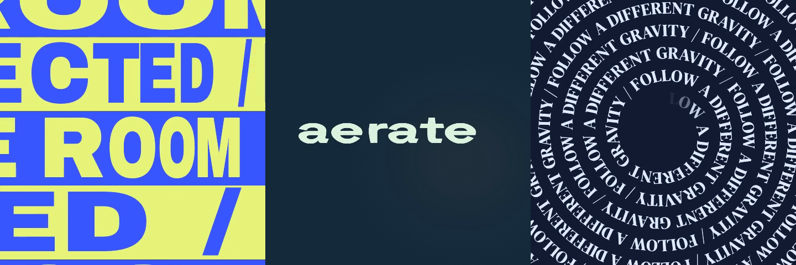

# Mont Workflows

Ready-to-run video workflows and editable motion templates for [Mont CLI](https://github.com/usemont/mont-cli).

[Try a template](#try-a-template) · [Kinetic typography](#kinetic-typography) · [Mock UI](#mock-ui) · [Notifications](#notifications) · [Social posts](#social-posts) · [Subscribe & follow](#subscribe--follow) · [Cursors](#cursors) · [Terminal showcase](#terminal-showcase) · [Workflows](#workflows) · [Contribute](#contribute)

## Try a template

```sh
# install (macOS)
brew install usemont/tap/mont
# generate preview
mont templates preview stretch-row-repeater
```

On Linux, use the [signed CLI installation guide](https://github.com/usemont/mont-cli/blob/main/docs/install.md#linux).

Saves `preview.mp4` and an editable project to `out/stretch-row-repeater/`.

Explore the latest collection with `mont templates list` and `mont workflows list`.
Inspect settings with `mont templates show <name>` before rendering.

**Image-template CLI requirement:** Image-backed templates require a CLI build with embedded-image template materialization support. `0.1.0-preview.16` does not support their standalone create/preview flow. The GIFs are independently viewable; availability of a public CLI release with this capability is not claimed here.

## Kinetic typography

<table>
<tr>
<td align="center" valign="top"><a href="templates/kinetic/stretch-row-repeater">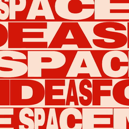</a><br><a href="templates/kinetic/stretch-row-repeater"><strong>Stretch row repeater</strong></a><br><code>mont templates preview stretch-row-repeater</code></td>
<td align="center" valign="top"><a href="templates/kinetic/letter-inflate-swell">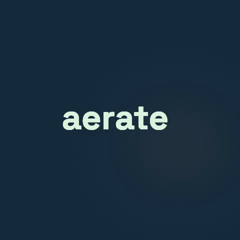</a><br><a href="templates/kinetic/letter-inflate-swell"><strong>Letter inflate swell</strong></a><br><code>mont templates preview letter-inflate-swell</code></td>
<td align="center" valign="top"><a href="templates/kinetic/spiral-type">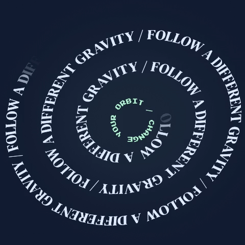</a><br><a href="templates/kinetic/spiral-type"><strong>Spiral type</strong></a><br><code>mont templates preview spiral-type</code></td>
</tr>
<tr>
<td align="center" valign="top"><a href="templates/kinetic/morph-text">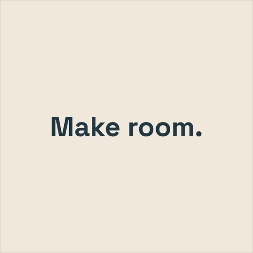</a><br><a href="templates/kinetic/morph-text"><strong>Morph text</strong></a><br><code>mont templates preview morph-text</code></td>
<td align="center" valign="top"><a href="templates/kinetic/bottom-up-letters"></a><br><a href="templates/kinetic/bottom-up-letters"><strong>Bottom-up letters</strong></a><br><code>mont templates preview bottom-up-letters</code></td>
<td align="center" valign="top"><a href="templates/kinetic/focus-blur-resolve">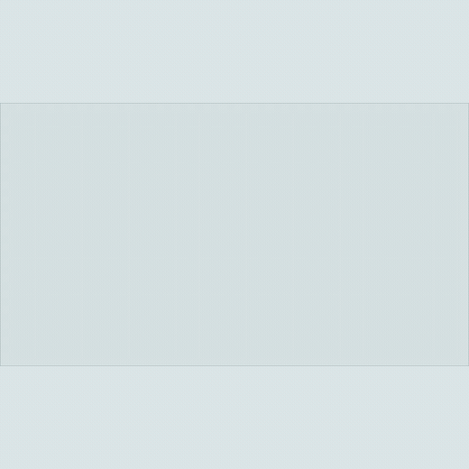</a><br><a href="templates/kinetic/focus-blur-resolve"><strong>Focus blur resolve</strong></a><br><code>mont templates preview focus-blur-resolve</code></td>
</tr>
<tr>
<td align="center" valign="top"><a href="templates/kinetic/camera-follow-captions">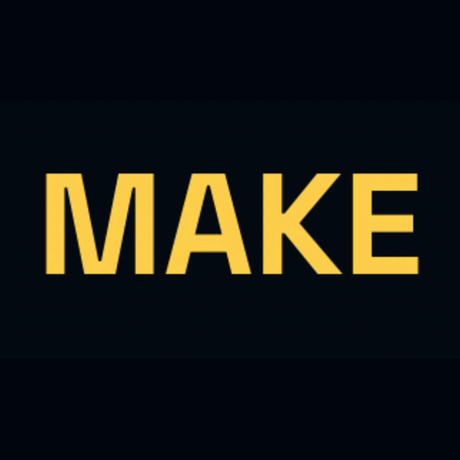</a><br><a href="templates/kinetic/camera-follow-captions"><strong>Camera follow captions</strong></a><br><code>mont templates preview camera-follow-captions</code></td>
<td align="center" valign="top"><a href="templates/kinetic/caret-swap">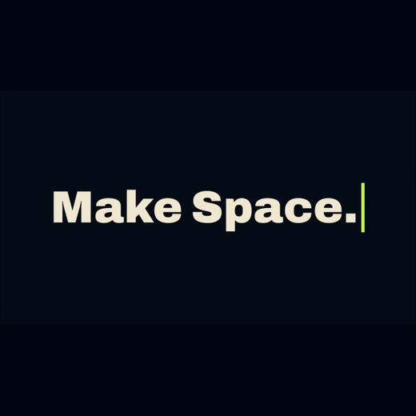</a><br><a href="templates/kinetic/caret-swap"><strong>Caret swap</strong></a><br><code>mont templates preview caret-swap</code></td>
</tr>
</table>

## Mock UI

<table>
<tr>
<td align="center" valign="top"><a href="templates/mock-ui/chatgpt-exchange">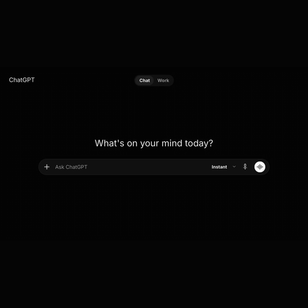</a><br><a href="templates/mock-ui/chatgpt-exchange"><strong>ChatGPT exchange</strong></a><br><code>mont templates preview chatgpt-exchange</code></td>
<td align="center" valign="top"><a href="templates/mock-ui/claude-exchange">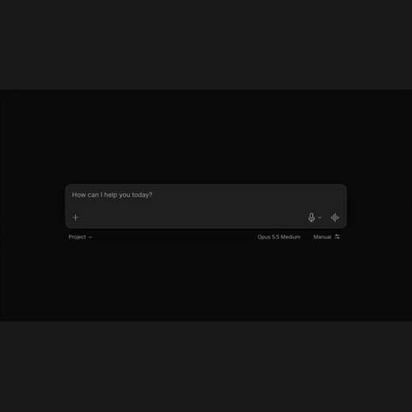</a><br><a href="templates/mock-ui/claude-exchange"><strong>Claude exchange</strong></a><br><code>mont templates preview claude-exchange</code></td>
</tr>
<tr>
<td align="center" valign="top" colspan="2"><a href="templates/mock-ui/ai-chat-reveal">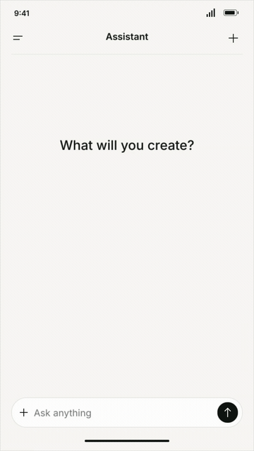</a><br><a href="templates/mock-ui/ai-chat-reveal"><strong>AI chat reveal</strong></a><br><code>python3 templates/mock-ui/ai-chat-reveal/create.py ./ai-chat</code><br><code>mont edit -C ./ai-chat</code><br>Includes the reusable <a href="templates/components/mobile-keyboard">mobile keyboard scene</a>.</td>
</tr>
</table>

## Notifications

<table>
<tr>
<td align="center" valign="top"><a href="templates/notifications/notification-cascade">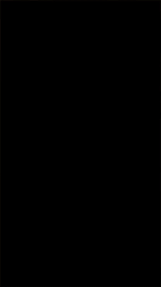</a><br><a href="templates/notifications/notification-cascade"><strong>Notification cascade</strong></a><br><code>mont templates preview notification-cascade</code></td>
<td align="center" valign="top"><a href="templates/notifications/slack-notification-ad">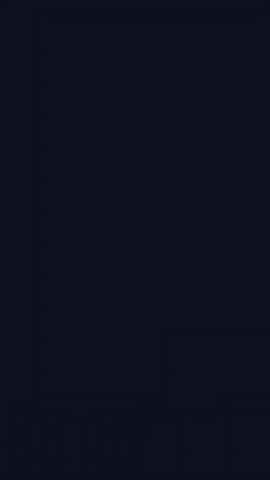</a><br><a href="templates/notifications/slack-notification-ad"><strong>Slack notification ad</strong></a><br><code>mont templates preview slack-notification-ad</code></td>
</tr>
</table>

## Social posts

<table>
<tr>
<td align="center" valign="top"><a href="templates/social-posts/comment-cards"></a><br><a href="templates/social-posts/comment-cards"><strong>Comment cards</strong></a><br><code>mont templates preview comment-cards</code></td>
</tr>
</table>

## Subscribe & follow

<table>
<tr>
<td align="center" valign="top"><a href="templates/subscribe/tiktok-follow"></a><br><a href="templates/subscribe/tiktok-follow"><strong>TikTok follow</strong></a><br><code>mont templates preview tiktok-follow</code></td>
<td align="center" valign="top"><a href="templates/subscribe/instagram-follow"></a><br><a href="templates/subscribe/instagram-follow"><strong>Instagram follow</strong></a><br><code>mont templates preview instagram-follow</code></td>
</tr>
<tr>
<td align="center" valign="top"><a href="templates/subscribe/creator-follow-card">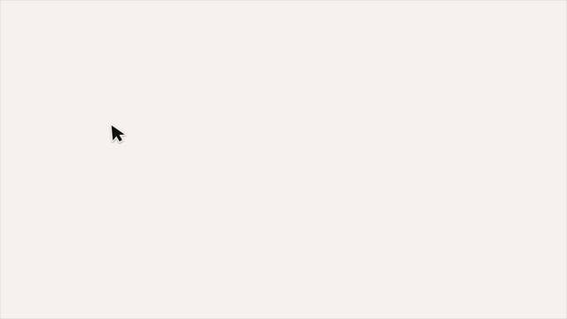</a><br><a href="templates/subscribe/creator-follow-card"><strong>Creator follow card</strong></a><br><code>mont templates preview creator-follow-card</code></td>
<td align="center" valign="top"><a href="templates/subscribe/youtube-subscribe"></a><br><a href="templates/subscribe/youtube-subscribe"><strong>YouTube subscribe</strong></a><br><code>mont templates preview youtube-subscribe</code></td>
</tr>
<tr>
<td align="center" valign="top" colspan="2"><a href="templates/subscribe/x-follow-card">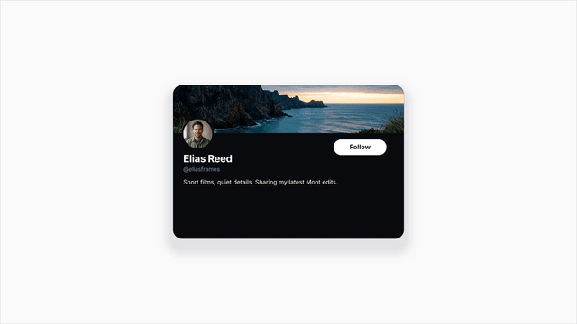</a><br><a href="templates/subscribe/x-follow-card"><strong>X follow card</strong></a><br><code>mont templates preview x-follow-card</code></td>
</tr>
</table>

## Cursors

<table>
<tr>
<td align="center" valign="top"><a href="templates/cursors/drag-and-drop">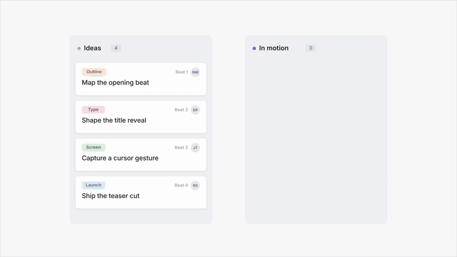</a><br><a href="templates/cursors/drag-and-drop"><strong>Drag and drop</strong></a><br><code>mont templates preview drag-and-drop</code></td>
</tr>
<tr>
<td align="center" valign="top"><a href="templates/cursors/text-select-cursor">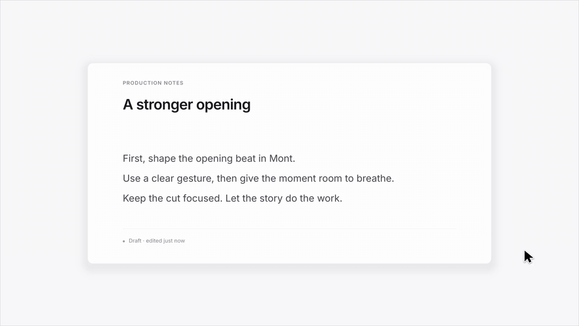</a><br><a href="templates/cursors/text-select-cursor"><strong>Text-select cursor</strong></a><br><code>mont templates preview text-select-cursor</code></td>
</tr>
</table>

## Terminal showcase

<table>
<tr>
<td align="center" valign="top"><a href="templates/showcase/terminal-showcase">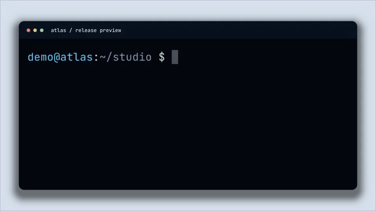</a><br><a href="templates/showcase/terminal-showcase"><strong>Terminal showcase</strong></a><br><code>mont templates preview terminal-showcase</code></td>
</tr>
</table>

## Workflows

- **[Markdown → narrated explainer](workflows/explainer)** — Markdown, scene generation, voice, captions, and MP4. **Experimental: visual review incomplete; uses paid APIs.** Read its [setup](workflows/explainer/README.md) and [security notes](workflows/explainer/SECURITY.md) first.

## Contribute

Contributions welcome via issues and pull requests. Review unfamiliar workflows before running them: they can send inputs to configured APIs. Never commit credentials or generated projects.

[Apache-2.0](LICENSE) · Nauchu AB · [Agent skills](https://github.com/usemont/skills) · [CLI releases](https://github.com/usemont/mont-cli/releases)
