<p><a href="https://usemont.com"></a></p>


# Mont Workflows

Preview animated templates, customize text and colors, and render videos from your terminal with [Mont CLI](https://github.com/usemont/mont-cli).

[Installation](#installation) · [Try a template](#try-a-template) · [Kinetic typography](#kinetic-typography) · [Product marketing](#product-marketing) · [Mock UI](#mock-ui) · [Notifications](#notifications) · [Social posts](#social-posts) · [Subscribe & follow](#subscribe--follow) · [Cursors](#cursors) · [Transitions](#transitions) · [Tools](#tools) · [Terminal showcase](#terminal-showcase) · [Workflows](#workflows) · [Contribute](#contribute)

## Installation

**Apple Silicon · macOS 14+ · Node.js 22+**

Install [Node.js 22 or newer](https://nodejs.org/en/download), then run:

```sh
npx usemont --help
npx usemont templates list
```

## Try a template

```sh
npx usemont templates preview morph-text
```

Preview opens an editable project at `out/morph-text/project`. Keep the web editor
command running while editing.

Install FFmpeg and ffprobe for media import and MP4 rendering.

## Kinetic typography

<table>
<tr>
<td align="center" valign="top"><a href="templates/kinetic/stretch-row-repeater"></a><br><a href="templates/kinetic/stretch-row-repeater"><strong>Stretch row repeater</strong></a><br><code>npx usemont templates preview stretch-row-repeater</code></td>
<td align="center" valign="top"><a href="templates/kinetic/letter-inflate-swell"></a><br><a href="templates/kinetic/letter-inflate-swell"><strong>Letter inflate swell</strong></a><br><code>npx usemont templates preview letter-inflate-swell</code></td>
<td align="center" valign="top"><a href="templates/kinetic/spiral-type"></a><br><a href="templates/kinetic/spiral-type"><strong>Spiral type</strong></a><br><code>npx usemont templates preview spiral-type</code></td>
</tr>
<tr>
<td align="center" valign="top"><a href="templates/kinetic/morph-text"></a><br><a href="templates/kinetic/morph-text"><strong>Morph text</strong></a><br><code>npx usemont templates preview morph-text</code></td>
<td align="center" valign="top"><a href="templates/kinetic/bottom-up-letters"></a><br><a href="templates/kinetic/bottom-up-letters"><strong>Bottom-up letters</strong></a><br><code>npx usemont templates preview bottom-up-letters</code></td>
<td align="center" valign="top"><a href="templates/kinetic/focus-blur-resolve"></a><br><a href="templates/kinetic/focus-blur-resolve"><strong>Focus blur resolve</strong></a><br><code>npx usemont templates preview focus-blur-resolve</code></td>
</tr>
<tr>
<td align="center" valign="top"><a href="templates/kinetic/camera-follow-captions"></a><br><a href="templates/kinetic/camera-follow-captions"><strong>Camera follow captions</strong></a><br><code>npx usemont templates preview camera-follow-captions</code></td>
<td align="center" valign="top"><a href="templates/kinetic/caret-swap"></a><br><a href="templates/kinetic/caret-swap"><strong>Caret swap</strong></a><br><code>npx usemont templates preview caret-swap</code></td>
</tr>
</table>

## Product marketing

<table>
<tr>
<td align="center" valign="top"><a href="templates/product-marketing/subscription-pile-up"></a><br><a href="templates/product-marketing/subscription-pile-up"><strong>Subscription pile-up</strong></a><br><code>npx usemont templates preview subscription-pile-up</code></td>
<td align="center" valign="top"><a href="templates/product-marketing/punch-through-words">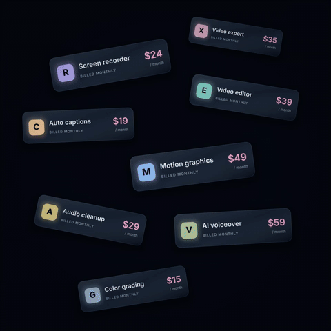</a><br><a href="templates/product-marketing/punch-through-words"><strong>Punch-through words</strong></a><br><code>npx usemont templates preview punch-through-words</code></td>
</tr>
<tr>
<td align="center" valign="top"><a href="templates/product-marketing/card-vortex">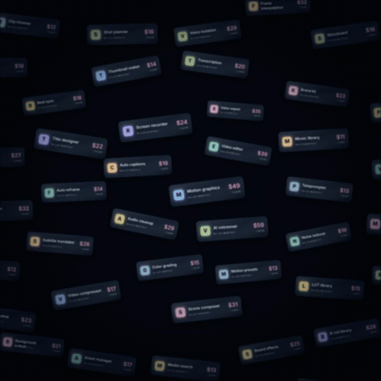</a><br><a href="templates/product-marketing/card-vortex"><strong>Card vortex</strong></a><br><code>npx usemont templates preview card-vortex</code></td>
<td align="center" valign="top"><a href="templates/product-marketing/tile-wall-reveal">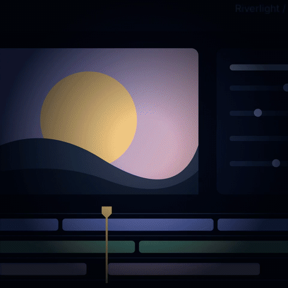</a><br><a href="templates/product-marketing/tile-wall-reveal"><strong>Tile wall reveal</strong></a><br><code>npx usemont templates preview tile-wall-reveal</code></td>
</tr>
</table>

## Mock UI

<table>
<tr>
<td align="center" valign="top"><a href="templates/mock-ui/chatgpt-exchange"></a><br><a href="templates/mock-ui/chatgpt-exchange"><strong>ChatGPT exchange</strong></a><br><code>npx usemont templates preview chatgpt-exchange</code></td>
<td align="center" valign="top"><a href="templates/mock-ui/claude-exchange"></a><br><a href="templates/mock-ui/claude-exchange"><strong>Claude exchange</strong></a><br><code>npx usemont templates preview claude-exchange</code></td>
</tr>
<tr>
<td align="center" valign="top" colspan="2"><a href="templates/mock-ui/ai-chat-reveal"></a><br><a href="templates/mock-ui/ai-chat-reveal"><strong>AI chat reveal</strong></a><br><code>npx --yes --package=usemont -- python3 templates/mock-ui/ai-chat-reveal/create.py ./ai-chat</code><br><code>npx usemont edit -C ./ai-chat</code><br>Includes the reusable <a href="templates/components/mobile-keyboard">mobile keyboard scene</a>.</td>
</tr>
</table>

## Notifications

<table>
<tr>
<td align="center" valign="top"><a href="templates/notifications/notification-cascade"></a><br><a href="templates/notifications/notification-cascade"><strong>Notification cascade</strong></a><br><code>npx usemont templates preview notification-cascade</code></td>
<td align="center" valign="top"><a href="templates/notifications/slack-notification-ad"></a><br><a href="templates/notifications/slack-notification-ad"><strong>Slack notification ad</strong></a><br><code>npx usemont templates preview slack-notification-ad</code></td>
</tr>
</table>

## Social posts

<table>
<tr>
<td align="center" valign="top"><a href="templates/social-posts/comment-cards"></a><br><a href="templates/social-posts/comment-cards"><strong>Comment cards</strong></a><br><code>npx usemont templates preview comment-cards</code></td>
</tr>
</table>

## Subscribe & follow

<table>
<tr>
<td align="center" valign="top"><a href="templates/subscribe/tiktok-follow"></a><br><a href="templates/subscribe/tiktok-follow"><strong>TikTok follow</strong></a><br><code>npx usemont templates preview tiktok-follow</code></td>
<td align="center" valign="top"><a href="templates/subscribe/instagram-follow"></a><br><a href="templates/subscribe/instagram-follow"><strong>Instagram follow</strong></a><br><code>npx usemont templates preview instagram-follow</code></td>
</tr>
<tr>
<td align="center" valign="top"><a href="templates/subscribe/creator-follow-card"></a><br><a href="templates/subscribe/creator-follow-card"><strong>Creator follow card</strong></a><br><code>npx usemont templates preview creator-follow-card</code></td>
<td align="center" valign="top"><a href="templates/subscribe/youtube-subscribe"></a><br><a href="templates/subscribe/youtube-subscribe"><strong>YouTube subscribe</strong></a><br><code>npx usemont templates preview youtube-subscribe</code></td>
</tr>
<tr>
<td align="center" valign="top" colspan="2"><a href="templates/subscribe/x-follow-card"></a><br><a href="templates/subscribe/x-follow-card"><strong>X follow card</strong></a><br><code>npx usemont templates preview x-follow-card</code></td>
</tr>
</table>

## Cursors

<table>
<tr>
<td align="center" valign="top"><a href="templates/cursors/drag-and-drop"></a><br><a href="templates/cursors/drag-and-drop"><strong>Drag and drop</strong></a><br><code>npx usemont templates preview drag-and-drop</code></td>
</tr>
<tr>
<td align="center" valign="top"><a href="templates/cursors/text-select-cursor"></a><br><a href="templates/cursors/text-select-cursor"><strong>Text-select cursor</strong></a><br><code>npx usemont templates preview text-select-cursor</code></td>
</tr>
<tr>
<td align="center" valign="top"><a href="templates/cursors/annotate-cursor">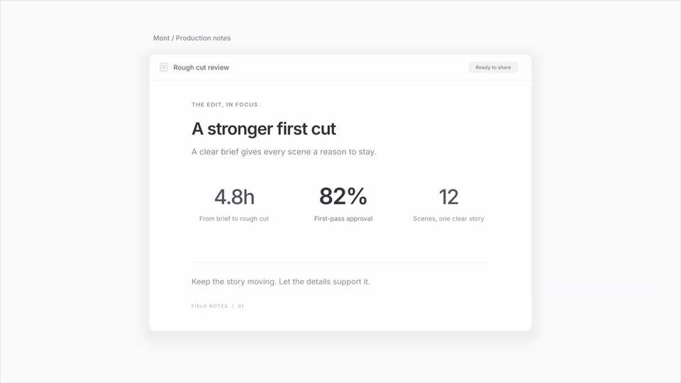</a><br><a href="templates/cursors/annotate-cursor"><strong>Annotate cursor</strong></a><br><code>npx usemont templates preview annotate-cursor</code></td>
</tr>
<tr>
<td align="center" valign="top"><a href="templates/cursors/agent-cursor">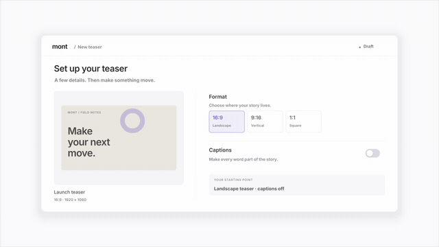</a><br><a href="templates/cursors/agent-cursor"><strong>Agent cursor</strong></a><br><code>npx usemont templates preview agent-cursor</code></td>
</tr>
<tr>
<td align="center" valign="top"><a href="templates/cursors/website-3d-cursor">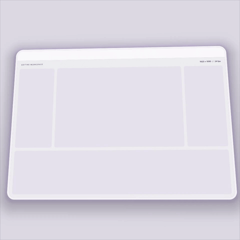</a><br><a href="templates/cursors/website-3d-cursor"><strong>Editor 3D assembly</strong></a><br><code>npx usemont templates preview website-3d-cursor</code></td>
</tr>
</table>

## Carousels

<table>
<tr>
<td align="center" valign="top"><a href="templates/carousels/circle-carousel">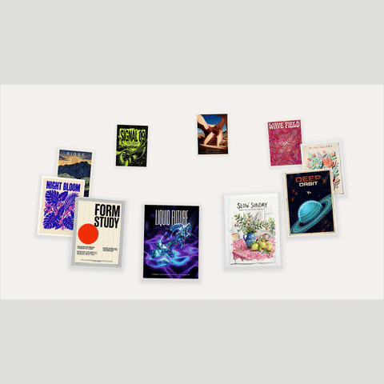</a><br><a href="templates/carousels/circle-carousel"><strong>Circle carousel</strong></a><br><code>npx usemont templates preview circle-carousel</code></td>
<td align="center" valign="top"><a href="templates/carousels/orbit-carousel">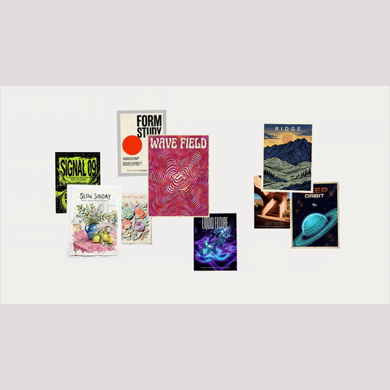</a><br><a href="templates/carousels/orbit-carousel"><strong>Orbit carousel</strong></a><br><code>npx usemont templates preview orbit-carousel</code></td>
<td align="center" valign="top"><a href="templates/carousels/path-carousel">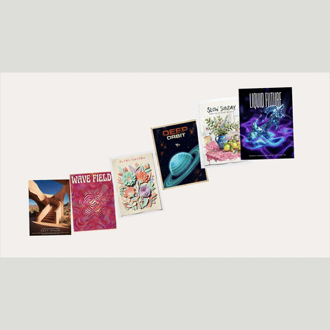</a><br><a href="templates/carousels/path-carousel"><strong>Path carousel</strong></a><br><code>npx usemont templates preview path-carousel</code></td>
</tr>
</table>

## Transitions

Square A/B previews. Each template includes a standalone scene and a reusable live-frame transition; see [timeline setup and licenses](templates/transitions/README.md).

<table>
<tr>
<td align="center" valign="top"><a href="templates/transitions/cube-flip-transition"></a><br><a href="templates/transitions/cube-flip-transition"><strong>Cube Flip</strong></a><br><code>npx usemont templates preview cube-flip-transition</code></td>
<td align="center" valign="top"><a href="templates/transitions/circular-wipe-transition"></a><br><a href="templates/transitions/circular-wipe-transition"><strong>Circular Wipe</strong></a><br><code>npx usemont templates preview circular-wipe-transition</code></td>
</tr>
<tr>
<td align="center" valign="top"><a href="templates/transitions/reverse-circle-wipe-transition">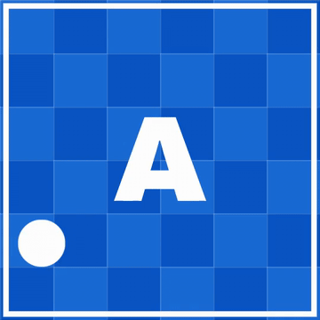</a><br><a href="templates/transitions/reverse-circle-wipe-transition"><strong>Reverse Circle Wipe</strong></a><br><code>npx usemont templates preview reverse-circle-wipe-transition</code></td>
<td align="center" valign="top"><a href="templates/transitions/dither-dissolve-transition">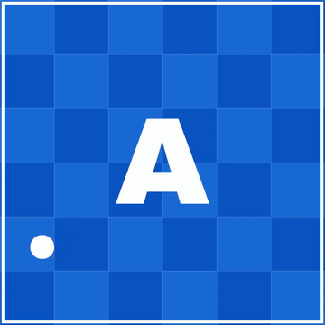</a><br><a href="templates/transitions/dither-dissolve-transition"><strong>Dither Dissolve</strong></a><br><code>npx usemont templates preview dither-dissolve-transition</code></td>
</tr>
<tr>
<td align="center" valign="top"><a href="templates/transitions/liquid-metal-wipe-transition"></a><br><a href="templates/transitions/liquid-metal-wipe-transition"><strong>Liquid Metal Wipe</strong></a><br><code>npx usemont templates preview liquid-metal-wipe-transition</code></td>
<td align="center" valign="top"><a href="templates/transitions/page-turn-transition"></a><br><a href="templates/transitions/page-turn-transition"><strong>Page Turn</strong></a><br><code>npx usemont templates preview page-turn-transition</code></td>
</tr>
<tr>
<td align="center" valign="top"><a href="templates/transitions/object-flyby-wipe-transition">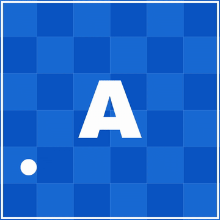</a><br><a href="templates/transitions/object-flyby-wipe-transition"><strong>Object Flyby Wipe</strong></a><br><code>npx usemont templates preview object-flyby-wipe-transition</code></td>
<td align="center" valign="top"><a href="templates/transitions/noise-field-dissolve-transition">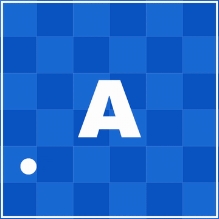</a><br><a href="templates/transitions/noise-field-dissolve-transition"><strong>Noise Field Dissolve</strong></a><br><code>npx usemont templates preview noise-field-dissolve-transition</code></td>
</tr>
</table>

## Tools

[Editable synthetic recorder examples](templates/tools), using the SDK's recording layouts, themes, and cursor styles.

<table>
<tr>
<td align="center" valign="top"><a href="templates/tools/corner-bubble">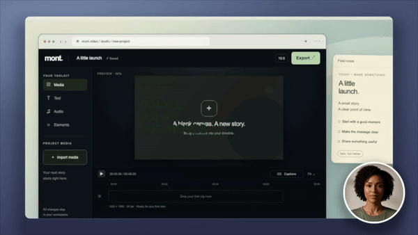</a><br><a href="templates/tools/corner-bubble"><strong>Corner bubble</strong></a><br><code>npx usemont tools preview corner-bubble</code></td>
<td align="center" valign="top"><a href="templates/tools/corner-tile">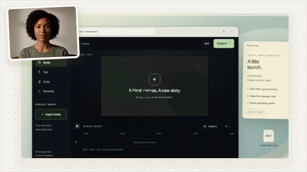</a><br><a href="templates/tools/corner-tile"><strong>Corner tile</strong></a><br><code>npx usemont tools preview corner-tile</code></td>
<td align="center" valign="top"><a href="templates/tools/side-by-side">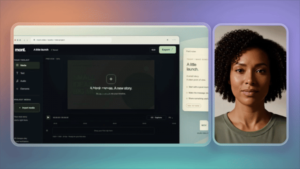</a><br><a href="templates/tools/side-by-side"><strong>Side by side</strong></a><br><code>npx usemont tools preview side-by-side</code></td>
</tr>
<tr>
<td align="center" valign="top"><a href="templates/tools/presenter">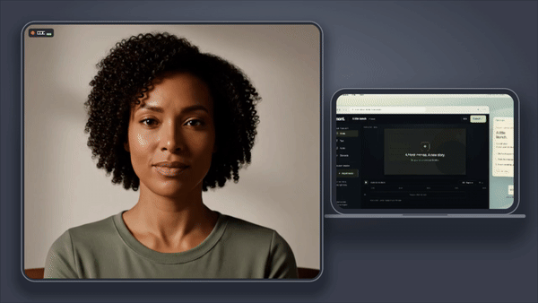</a><br><a href="templates/tools/presenter"><strong>Presenter</strong></a><br><code>npx usemont tools preview presenter</code></td>
<td align="center" valign="top"><a href="templates/tools/edge-bubble">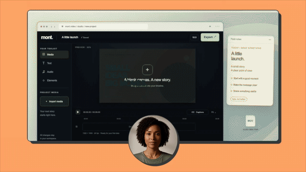</a><br><a href="templates/tools/edge-bubble"><strong>Edge bubble</strong></a><br><code>npx usemont tools preview edge-bubble</code></td>
<td align="center" valign="top"><a href="templates/tools/screen-only">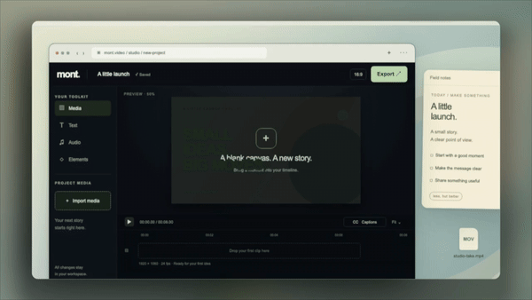</a><br><a href="templates/tools/screen-only"><strong>Screen only</strong></a><br><code>npx usemont tools preview screen-only</code></td>
</tr>
<tr>
<td align="center" valign="top"><a href="templates/tools/cinematic">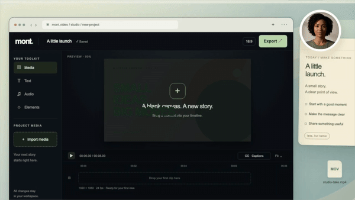</a><br><a href="templates/tools/cinematic"><strong>Cinematic</strong></a><br><code>npx usemont tools preview cinematic</code></td>
<td align="center" valign="top"><a href="templates/tools/shorts-stack">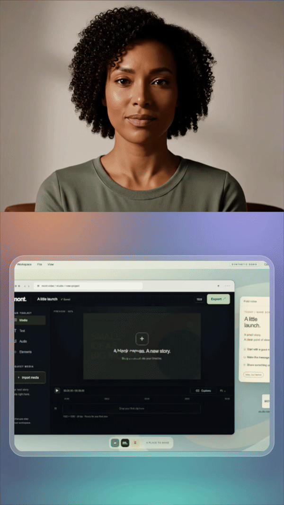</a><br><a href="templates/tools/shorts-stack"><strong>Shorts stack</strong></a><br><code>npx usemont tools preview shorts-stack</code></td>
<td align="center" valign="top"><a href="templates/tools/square-post"></a><br><a href="templates/tools/square-post"><strong>Square post</strong></a><br><code>npx usemont tools preview square-post</code></td>
</tr>
<tr>
<td align="center" valign="top"><a href="templates/tools/camera-only"></a><br><a href="templates/tools/camera-only"><strong>Camera only</strong></a><br><code>npx usemont tools preview camera-only</code></td>
</tr>
</table>

## Terminal showcase

<table>
<tr>
<td align="center" valign="top"><a href="templates/showcase/terminal-showcase"></a><br><a href="templates/showcase/terminal-showcase"><strong>Terminal showcase</strong></a><br><code>npx usemont templates preview terminal-showcase</code></td>
</tr>
</table>

## Workflows

- **[Markdown → narrated explainer](workflows/explainer)** — Markdown, scene generation, voice, captions, and MP4. **Experimental · paid APIs.** Follow the [setup](workflows/explainer/README.md) and [security notes](workflows/explainer/SECURITY.md).

## Contribute

Contributions welcome via issues and pull requests. Review unfamiliar workflows before running them: they can send inputs to configured APIs. Never commit credentials or generated projects.

Check carousel motion: `node templates/carousels/verify.mjs`.

[Apache-2.0](LICENSE) · Nauchu AB · [Agent skills](https://github.com/usemont/skills) · [CLI releases](https://github.com/usemont/mont-cli/releases)
