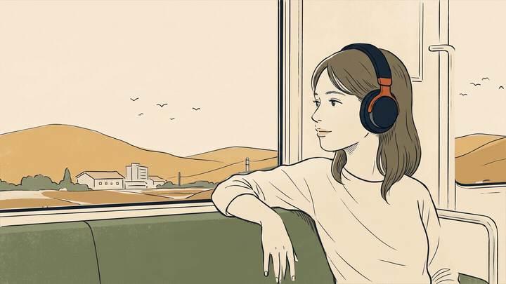

# Step-by-step explainer

How noise-cancelling headphones reduce train rumble. 1920 × 1080, 24 seconds, 30 fps. Silent.

[](../../../assets/previews/explainer-steps.mp4)

```sh
npx usemont templates preview explainer-steps
```

To create an editable workspace and render locally, install [Mont CLI](https://github.com/usemont/mont-cli), Python 3 and Node.js, then run:

```sh
python3 templates/explainers/explainer-steps/create.py /tmp/noise-cancellation \
  --output /tmp/noise-cancellation.mp4
```

`--inputs inputs.json` overrides scene variables: `title`, `step1`, `step2`, `step3`, `takeaway`, `caveat`, `accent`, `counter`, `ink`, `paper`. This example has three authored steps; changing its subject also requires appropriate illustration layers and waveform logic.

## Animation

- 0–3 s: train illustration and opening title.
- 3–8 s: gentle camera push toward the headphones; microphone highlight and incoming noise.
- 8–13.7 s: opposite-phase sound appears below the incoming wave.
- 13.7–20 s: waves converge; the resulting waveform becomes smaller.
- 20–24 s: camera returns to the train composition; takeaway and limitation.

The example is conceptual, not an acoustic simulation. Active noise cancellation works especially well on steady, low-frequency sound; the residual waveform deliberately remains nonzero.

## Artwork

Three PNG layers are embedded in `scene.tsx`: a landscape, a train interior with transparent windows, and a passenger with a hand-traced alpha boundary. The passenger retains the approved generated illustration, not automatic vectorization. Landscape translation runs behind the window openings; the passenger has restrained subpixel vibration. Waveforms, microphone highlight, labels and progress are native Mont elements.

Generation model, prompts and source hashes are recorded in `assets/provenance.json`. No third-party reference illustrations are included.

The creator runs deterministic checks for easing boundaries/monotonicity and exact opposite phase before creating the project.
