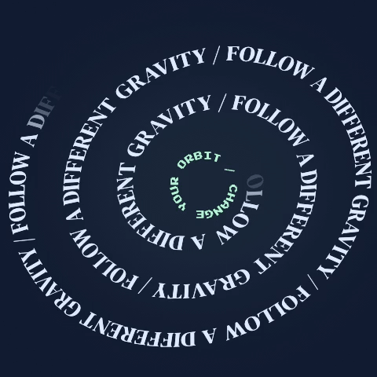

# Spiral type

Repeated text follows one continuous spiral with tangent rotation.



## Try it

```sh
# install (macOS)
brew install usemont/tap/mont
# generate preview
mont spiral-type
```

On Linux, use the [signed CLI installation guide](https://github.com/usemont/mont-cli/blob/main/docs/install.md#linux).

Outputs: `out/spiral-type/preview.mp4` and editable `out/spiral-type/project/`. Reruns create `out/spiral-type-2/`, then `-3/`, without overwriting previous output.

## Make it yours

Save this as `settings.json` in your current directory:

```json
{"text":"IDEAS IN MOTION","width":1080,"height":1920}
```

```sh
mont spiral-type --inputs settings.json
```

| Format | Width × height |
| --- | --- |
| Landscape · 16:9 | 1920 × 1080 |
| Portrait · 9:16 | 1080 × 1920 |
| Square · 1:1 | 1080 × 1080 |

`background` and `ink` set the palette; `speed`, `innerRadius`, and `pitch` control the spiral. See [template.mont](template.mont) for all inputs; edit [scene.tsx](scene.tsx) to change the animation.

No inference API key needed. First use of a non-embedded font needs network access.
