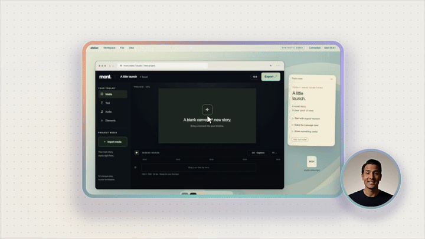

# Feature launch

**Category:** Launch videos · **Canvas:** 1920 × 1080 · **Duration:** 12 seconds

Headline reveal → product panel entrance → one feature callout → logo, CTA and link.
The example uses **Forma**, a fictional video editor with original copy and native vector UI.
This is the reusable template; Mont's own launch video is a separate example.

[](../../../assets/previews/recording-layouts-launch.mp4)

The [Mont recording-layouts example](#mont-recording-layouts-example) below is the
18-second launch video shown in this preview.

## Create and render

Requires Mont CLI and Node.js (for the small easing self-check). No Python packages required.

```sh
python3 create.py /tmp/feature-launch-project --output /tmp/feature-launch.mp4
```

Use a new workspace path. The resulting Mont project retains the scene source, variables,
child scene and embedded image resources; the MP4 is not the editable source.
The command checks the entrance easing bounds/monotonicity before creating the project.

```sh
python3 create.py /tmp/my-launch-project \
  --inputs /path/to/inputs.json \
  --ui-image /path/to/product.png \
  --logo-image /path/to/logo.png \
  --output /tmp/my-launch.mp4
```

PNG, JPEG and WebP are embedded, so the project does not depend on their original file paths.
Images preserve their aspect ratio inside the product panel and logo slot.
Instead of `--ui-image`, use `--ui-scene /path/to/product-ui.tsx` for a standalone
native Mont scene authored at **1360 × 650**, without external dependencies.
The bundled `product-ui.tsx` demonstrates this slot; its `accent` and `brand` inputs
follow the parent variables. The child runs on the parent's clock.

## Variables

Supply a JSON object through `--inputs`. Unspecified values retain their TSX defaults.

| Variable | Purpose |
| --- | --- |
| `headline` | Opening headline; explicit `\n` supported; author for two lines |
| `subline` | One supporting line |
| `featureTitle`, `featureBody` | Single callout title and short supporting copy |
| `brand`, `endline` | Brand name and end-card statement |
| `ctaText`, `link` | CTA label and displayed destination; not an interactive MP4 link |
| `accent` | Accent colour shared by callout, CTA, logo tile and bundled UI selection |
| `background`, `foreground`, `muted` | Stage and text palette |
| `uiImage`, `useUiImage` | Resource reference and image/child-scene switch; set by `--ui-image` |
| `logoImage`, `useLogoImage` | Resource reference and custom/default logo switch; set by `--logo-image` |

Example:

```json
{
  "headline": "Make room for\nyour next idea.",
  "subline": "A calmer way to bring your videos together.",
  "featureTitle": "Every detail. One timeline.",
  "featureBody": "Shape the cut without losing the bigger picture.",
  "brand": "Forma",
  "accent": "#C8F27C",
  "ctaText": "Explore Forma",
  "link": "forma.example"
}
```

The template uses native Mont `Group`, `Text`, shape, mask, image and `AssetScene`
capabilities. No HTML recording or new renderer implementation. Entrance, reframe,
callout and end-card timings are authored in `scene.tsx`; the panel keeps a restrained
drift while the product scene plays. Copy slots are designed for concise launch messaging,
not arbitrary-length text or localization (covered by the localized lesson template).

## Mont recording-layouts example

`recording-layouts.tsx` is an 18-second, 1920 × 1080 example:
corner bubble → side by side → presenter → corner bubble, followed by the Mont end card.
Screen and camera keep playing through the changes; their rectangles and crops tween
inside the existing Mont recorder layout scene, rather than cutting between recordings.

```sh
python3 create-recording-layouts.py /tmp/mont-layouts-project \
  --output /tmp/mont-layouts.mp4
```

The creator imports the original synthetic desktop and the new fictional speaking
presenter (`presenter-explaining.mp4`) from `assets/template-media/recorders`.
The desktop uses a slowed source clock; the presenter runs continuously at normal
speed. The cursor preserves recorded click times, travels in 0.4–0.7 seconds with
smooth curved easing, then holds at its target. The creator checks click alignment,
travel speed, transition continuity and layout bounds. `recording-assets.json` pins
the native recorder layout, glass borders and cursor scenes; no renderer extensions
are required.
Layout endpoints use the recorder's corner-bubble, side-by-side and presenter presets.
The circular corner camera extends below the screen; side-by-side gives both equal heights.
Screen, camera masks and glass borders share the same interpolated geometry.
Layout changes use a quick asymmetric cubic acceleration and a longer, overshoot-free
settle over 1.1–1.15 seconds. The selector leads each change with a 400 ms quartic-out
slide; the title and end-card copy have separate quartic-out entrances. End-card copy
waits until the recording has moved aside, avoiding overlap during the reframe.
The standard orange Mont mark and a readable pale dot grid with a moving warm
gradient and subtle grid drift stay outside the recording composition.

For this continuous scripted demo, the cursor scene receives `cursorAutoHide:false`,
`previewActive:true` and `cursorAutoShape:false`: it stays visible through clicks and
idle holds, including the opening frame, and stays an arrow when clicking. Native
studio-pack smoothing, motion blur and click animation remain enabled. Other cursor
consumers retain their default idle fade and shape behavior.
The bottom layout selector uses a dark container, light inactive labels and an orange
active tab with dark text, sized for readability in a small video preview.
The end card contains the logo, layout message and URL, without “Try Mont”.
