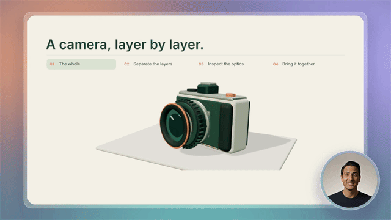
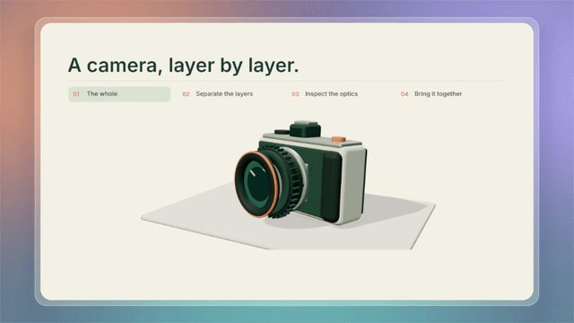

# Camera assembly

**Tools → Scene presentations** · 16:9 · 10 seconds · 24 fps

A four-step 3D camera study: assembled camera, separated layers, optics inspection, and reassembly. Step changes tween for 800 ms; a brief reversal demonstrates changing direction before the previous transition has finished. Only the title and step labels remain on screen.

| Scene + presenter | Scene only |
| --- | --- |
| [](../../../../assets/previews/camera-assembly-scene-camera.mp4) | [](../../../../assets/previews/camera-assembly-scene-only.mp4) |

## Create an editable project

From a checkout of this repository, with a current Mont CLI/SDK build supporting unified `source` and animated nested 3D scenes:

```sh
python3 templates/tools/scene-presentations/camera-assembly/create.py /tmp/camera-lesson \
  --variant scene-camera --output /tmp/camera-lesson.mp4

python3 templates/tools/scene-presentations/camera-assembly/create.py /tmp/camera-scene \
  --variant scene-only --output /tmp/camera-scene.mp4
```

`--presenter /path/to/footage.mp4` replaces the synthetic presenter. No capture-device access is requested. The preview presenter is a fictional AI-generated adult; [generation provenance](../../../../assets/template-media/recorders/presenter-explaining.provenance.json). Both examples are silent.

## Edit

- `scene.tsx`: camera geometry, materials, lighting, title, step labels, and animation formulas. `step` is the selected integer state; `stepPosition` is its continuous, tweened position. This is not restricted to slides.
- `recording.example.json`: editable SDK-generated layout, Glass theme decorations, held step events, and transition values for both variants. Step events are at 0, 1500, 3500, 3900, 5000, and 7500 ms. Change event timing and the corresponding `stepPosition` segments together.
- `create.py`: fills local media and scene inputs, then dispatches the ordinary programmatic-span creation command. It does not implement recording or interpolation semantics.

The scene takes its clock from the supplied `step`/`stepPosition` inputs; use `create.py` to play the example sequence. These are editable playback templates, not a command for starting a live recording session. The camera variant reuses the SDK's corner-bubble layout and Glass theme; the scene-only variant uses its screen-only layout.

[Apache-2.0](../../../../LICENSE)
